# 📊 Veri Tasarım Dokümantasyonu (Data Design Documentation - DDD)

Bu doküman, **Alumni Tracking System (Mezun Bilgi ve Kariyer Takip Sistemi)** projesinin ilişkisel veritabanı (PostgreSQL) mimarisini, tablo yapılarını, veri tiplerini, kısıtlamalarını (constraints), birincil/yabancı anahtarlarını (PK/FK) ve varlıklar arası ilişkilerini (ER Diyagramı) detaylandırmaktadır.

> 🔗 **Dokümantasyon Bağlantısı:**
> - Ana proje mimarisi, kurulum ve MVC detayları için ➡️ [README.md](./README.md) dosyasına bakınız.
> - Bu dokümandan [README.md](./README.md) dosyasına ve [README.md](./README.md) dosyasından bu dokümana çift yönlü bağlantı (`ddd.md <=> README.md`) kurulmuştur.

---

## 🗺️ Varlık - İlişki Diyagramı (Entity - Relationship Diagram)

Aşağıdaki Mermaid ER diyagramı sistemdeki tüm tabloları ve birbirleriyle olan kardinalite (ilişki) bağlarını göstermektedir:

```mermaid
erDiagram
    users ||--o| profiles : "has profile (1:1)"
    users ||--o{ academic_histories : "has academics (1:N)"
    users ||--o{ work_experiences : "has careers (1:N)"
    users ||--o{ user_skills : "has skills (1:N)"
    skills ||--o{ user_skills : "assigned to (1:N)"
    users ||--o{ mentorship_requests : "mentors / requests (1:N)"
    users ||--o{ job_postings : "publishes (1:N)"
    job_postings ||--o{ applications : "receives (1:N)"
    users ||--o{ applications : "applies (1:N)"
    users ||--o{ events : "organizes (1:N)"
    events ||--o{ event_rsvps : "has RSVPs (1:N)"
    users ||--o{ event_rsvps : "attends (1:N)"
    users ||--o{ announcements : "authored by (1:N)"

    users {
        string id PK "UUID / TEXT"
        string email UK "NOT NULL, UNIQUE"
        string passwordHash "NULLABLE"
        string name "NOT NULL"
        string role "ENUM: STUDENT, ALUMNI, ADMIN, FACULTY"
        int graduationYear "NULLABLE"
        string department "NULLABLE"
        string company "NULLABLE"
        boolean isVerified "DEFAULT false"
        string avatarUrl "NULLABLE"
        datetime createdAt "DEFAULT now()"
        datetime updatedAt "NOT NULL"
    }

    profiles {
        string id PK "UUID / TEXT"
        string userId FK "UNIQUE, NOT NULL -> users(id) ON DELETE CASCADE"
        string firstName "NOT NULL"
        string lastName "NOT NULL"
        string headline "NULLABLE"
        string bio "TEXT, NULLABLE"
        string phone "NULLABLE"
        string location "NULLABLE"
        string linkedinUrl "NULLABLE"
        string githubUrl "NULLABLE"
        string websiteUrl "NULLABLE"
        boolean isMentor "DEFAULT false"
        string mentorshipTopics "NULLABLE"
        datetime createdAt "DEFAULT now()"
        datetime updatedAt "NOT NULL"
    }

    academic_histories {
        string id PK "UUID / TEXT"
        string userId FK "NOT NULL -> users(id) ON DELETE CASCADE"
        string university "DEFAULT 'İstanbul Üniversitesi'"
        string faculty "NOT NULL"
        string department "NOT NULL, INDEXED"
        string degree "DEFAULT 'Lisans'"
        int startYear "NOT NULL"
        int graduationYear "NOT NULL, INDEXED"
        datetime createdAt "DEFAULT now()"
        datetime updatedAt "NOT NULL"
    }

    work_experiences {
        string id PK "UUID / TEXT"
        string userId FK "NOT NULL -> users(id) ON DELETE CASCADE"
        string company "NOT NULL, INDEXED"
        string position "NOT NULL"
        string industry "NOT NULL, INDEXED"
        string location "NULLABLE"
        datetime startDate "NOT NULL"
        datetime endDate "NULLABLE"
        boolean isCurrent "DEFAULT false"
        string description "TEXT, NULLABLE"
        datetime createdAt "DEFAULT now()"
        datetime updatedAt "NOT NULL"
    }

    skills {
        string id PK "UUID / TEXT"
        string name UK "NOT NULL, UNIQUE"
        datetime createdAt "DEFAULT now()"
    }

    user_skills {
        string id PK "UUID / TEXT"
        string userId FK "NOT NULL -> users(id) ON DELETE CASCADE"
        string skillId FK "NOT NULL -> skills(id) ON DELETE CASCADE"
        datetime createdAt "DEFAULT now()"
    }

    mentorship_requests {
        string id PK "UUID / TEXT"
        string mentorId FK "NOT NULL -> users(id) ON DELETE CASCADE"
        string menteeId FK "NOT NULL -> users(id) ON DELETE CASCADE"
        string status "ENUM: PENDING, ACCEPTED, REJECTED, COMPLETED"
        string message "TEXT, NOT NULL"
        string meetingUrl "NULLABLE"
        string notes "TEXT, NULLABLE"
        datetime createdAt "DEFAULT now()"
        datetime updatedAt "NOT NULL"
    }

    job_postings {
        int id PK "SERIAL (AUTO_INCREMENT)"
        string authorId FK "NOT NULL -> users(id) ON DELETE CASCADE"
        string title "NOT NULL"
        string company "NOT NULL"
        string location "NOT NULL"
        string type "ENUM: FULL_TIME, PART_TIME, INTERNSHIP, REMOTE, CONTRACT"
        string industry "NULLABLE, INDEXED"
        string description "TEXT, NOT NULL"
        string requirements "TEXT, NULLABLE"
        string applicationUrl "NULLABLE"
        string salaryRange "NULLABLE"
        boolean isActive "DEFAULT true"
        datetime createdAt "DEFAULT now()"
        datetime updatedAt "NOT NULL"
    }

    applications {
        int id PK "SERIAL (AUTO_INCREMENT)"
        int jobId FK "NOT NULL -> job_postings(id) ON DELETE CASCADE"
        string userId FK "NOT NULL -> users(id) ON DELETE CASCADE"
        string status "ENUM: PENDING, REVIEWED, ACCEPTED, REJECTED"
        string coverLetter "TEXT, NULLABLE"
        datetime createdAt "DEFAULT now()"
        datetime updatedAt "NOT NULL"
    }

    events {
        string id PK "UUID / TEXT"
        string organizerId FK "NOT NULL -> users(id) ON DELETE CASCADE"
        string title "NOT NULL"
        string description "TEXT, NOT NULL"
        string location "NOT NULL"
        datetime eventDate "NOT NULL"
        boolean isOnline "DEFAULT false"
        string meetingUrl "NULLABLE"
        int maxAttendees "NULLABLE"
        datetime createdAt "DEFAULT now()"
        datetime updatedAt "NOT NULL"
    }

    event_rsvps {
        string id PK "UUID / TEXT"
        string eventId FK "NOT NULL -> events(id) ON DELETE CASCADE"
        string userId FK "NOT NULL -> users(id) ON DELETE CASCADE"
        string status "ENUM: ATTENDING, MAYBE, DECLINED"
        datetime createdAt "DEFAULT now()"
    }

    announcements {
        int id PK "SERIAL AUTO_INCREMENT"
        string title "NOT NULL"
        string content "TEXT, NOT NULL"
        string author "NOT NULL"
        string category "ENUM: GENERAL, EVENT, CAREER, ACADEMIC, URGENT"
        string priority "ENUM: LOW, MEDIUM, HIGH"
        datetime publishedAt "DEFAULT now()"
        string authorUserId FK "NULLABLE -> users(id) ON DELETE SET NULL"
        datetime createdAt "DEFAULT now()"
        datetime updatedAt "NOT NULL"
    }

    alumni_records {
        int id PK "SERIAL AUTO_INCREMENT"
        string name "NOT NULL"
        string email "NULLABLE"
        int graduationYear "NOT NULL, INDEXED"
        string department "NULLABLE, INDEXED"
        string company "NULLABLE"
        string role "DEFAULT 'Software Engineer'"
        datetime createdAt "DEFAULT now()"
        datetime updatedAt "NOT NULL"
    }
```



---

## 🗄️ Detaylı Tablo ve Alan Spesifikasyonları

### 1. `users` (Kullanıcılar Tablosu)
Sisteme giriş yapan, mezun profilini yöneten ve platformda etkileşimde bulunan tüm aktörlerin ana kimlik tablosudur.

| Kolon | Tip | Kısıtlama (Constraints) | Açıklama |
| :--- | :--- | :--- | :--- |
| `id` | `INT` | `PRIMARY KEY, AUTO_INCREMENT` | Benzersiz kullanıcı tanımlayıcısı |
| `email` | `VARCHAR(255)` | `UNIQUE, NOT NULL` | E-posta adresi (Giriş anahtarı) |
| `passwordHash` | `VARCHAR(255)` | `NULLABLE` | Bcrypt ile hash'lenmiş şifre |
| `name` | `VARCHAR(255)` | `NOT NULL` | Ad ve Soyad |
| `role` | `ENUM` | `DEFAULT 'STUDENT'` | Rol: `STUDENT`, `ALUMNI`, `ADMIN`, `FACULTY` |
| `graduationYear` | `INT` | `NULLABLE, INDEX` | Mezuniyet yılı |
| `department` | `VARCHAR(255)` | `NULLABLE, INDEX` | Mezun olunan / okunan bölüm |
| `company` | `VARCHAR(255)` | `NULLABLE` | Mevcut çalıştığı şirket / kurum |
| `isVerified` | `BOOLEAN` | `DEFAULT false` | Mezuniyet doğrulama onay bayrağı |
| `avatarUrl` | `VARCHAR(500)` | `NULLABLE` | Profil fotoğrafı URL adresi |
| `createdAt` | `TIMESTAMP` | `DEFAULT CURRENT_TIMESTAMP` | Kayıt tarihi |
| `updatedAt` | `TIMESTAMP` | `NOT NULL` | Son güncelleme tarihi |

---

### 2. `profiles` (Genişletilmiş Mezun Profili)
Kullanıcının detaylı biyografisi, sosyal ağları ve mentorluk tercihlerini barındıran 1:1 ilişki tablosudur.

| Kolon | Tip | Kısıtlama | Açıklama |
| :--- | :--- | :--- | :--- |
| `id` | `INT` | `PRIMARY KEY, AUTO_INCREMENT` | Profil kayıt ID |
| `userId` | `INT` | `UNIQUE, NOT NULL, FK -> users(id)` | Bağlı kullanıcı (Birebir ilişki) |
| `firstName` | `VARCHAR(100)` | `NOT NULL` | Adı |
| `lastName` | `VARCHAR(100)` | `NOT NULL` | Soyadı |
| `headline` | `VARCHAR(255)` | `NULLABLE` | Ünvan (Örn: Senior Software Engineer @ Google) |
| `bio` | `TEXT` | `NULLABLE` | Detaylı özgeçmiş / açıklama |
| `phone` | `VARCHAR(50)` | `NULLABLE` | İletişim telefonu |
| `location` | `VARCHAR(100)` | `NULLABLE` | Şehir, Ülke |
| `linkedinUrl` | `VARCHAR(255)` | `NULLABLE` | LinkedIn profili |
| `githubUrl` | `VARCHAR(255)` | `NULLABLE` | GitHub profili |
| `websiteUrl` | `VARCHAR(255)` | `NULLABLE` | Kişisel web sitesi |
| `isMentor` | `BOOLEAN` | `DEFAULT false` | Mentorluk vermeye hazır mı? |
| `mentorshipTopics`| `TEXT` | `NULLABLE` | Mentorluk verilebilecek uzmanlık alanları |
| `createdAt` | `TIMESTAMP` | `DEFAULT CURRENT_TIMESTAMP` | Oluşturulma tarihi |
| `updatedAt` | `TIMESTAMP` | `NOT NULL` | Güncellenme tarihi |

---

### 3. `academic_histories` (Akademik Geçmiş)
Kullanıcıların lisans, yüksek lisans ve doktora gibi eğitim bilgilerini saklar (1:N ilişki).

| Kolon | Tip | Kısıtlama | Açıklama |
| :--- | :--- | :--- | :--- |
| `id` | `INT` | `PRIMARY KEY, AUTO_INCREMENT` | Eğitim kayıt ID |
| `userId` | `INT` | `NOT NULL, FK -> users(id)` | Kullanıcı referansı |
| `university` | `VARCHAR(255)` | `DEFAULT 'İstanbul Üniversitesi'` | Üniversite adı |
| `faculty` | `VARCHAR(255)` | `NOT NULL` | Fakülte |
| `department` | `VARCHAR(255)` | `NOT NULL, INDEX` | Bölüm |
| `degree` | `VARCHAR(100)` | `DEFAULT 'Lisans'` | Lisans, Yüksek Lisans, Doktora |
| `startYear` | `INT` | `NOT NULL` | Başlangıç yılı |
| `graduationYear` | `INT` | `NOT NULL, INDEX` | Mezuniyet yılı |
| `createdAt` | `TIMESTAMP` | `DEFAULT CURRENT_TIMESTAMP` | Kayıt tarihi |
| `updatedAt` | `TIMESTAMP` | `NOT NULL` | Güncellenme tarihi |

---

### 4. `work_experiences` (İş ve Kariyer Deneyimleri)
Mezunların çalıştığı kurumlar, sektörler ve pozisyon geçmişi.

| Kolon | Tip | Kısıtlama | Açıklama |
| :--- | :--- | :--- | :--- |
| `id` | `INT` | `PRIMARY KEY, AUTO_INCREMENT` | İş deneyimi ID |
| `userId` | `INT` | `NOT NULL, FK -> users(id)` | Kullanıcı referansı |
| `company` | `VARCHAR(255)` | `NOT NULL, INDEX` | Şirket / Kurum adı |
| `position` | `VARCHAR(255)` | `NOT NULL` | Pozisyon / Ünvan |
| `industry` | `VARCHAR(150)` | `NOT NULL, INDEX` | Sektör (Yazılım, Finans, Sağlık vb.) |
| `location` | `VARCHAR(150)` | `NULLABLE` | Şehir / Çalışma modeli |
| `startDate` | `TIMESTAMP` | `NOT NULL` | İşe başlama tarihi |
| `endDate` | `TIMESTAMP` | `NULLABLE` | İşten ayrılma tarihi |
| `isCurrent` | `BOOLEAN` | `DEFAULT false` | Halen bu pozisyonda mı çalışıyor? |
| `description` | `TEXT` | `NULLABLE` | Görev ve sorumluluk açıklaması |
| `createdAt` | `TIMESTAMP` | `DEFAULT CURRENT_TIMESTAMP` | Kayıt tarihi |
| `updatedAt` | `TIMESTAMP` | `NOT NULL` | Güncellenme tarihi |

---

### 5. `skills` & `user_skills` (Yetenekler ve Kullanıcı İlişkileri)
Platformdaki yetenek kataloğu ve kullanıcılar ile yetenekler arasındaki Çoktan-Çoğa (N:M) ilişki tablosu.

- **`skills` Tablosu:**
  - `id` (`INT`, PK, Auto-Increment)
  - `name` (`VARCHAR(100)`, UNIQUE, NOT NULL)
  - `createdAt` (`TIMESTAMP`)

- **`user_skills` Tablosu:**
  - `id` (`INT`, PK, Auto-Increment)
  - `userId` (`INT`, NOT NULL, FK -> `users(id)` ON DELETE CASCADE)
  - `skillId` (`INT`, NOT NULL, FK -> `skills(id)` ON DELETE CASCADE)
  - `createdAt` (`TIMESTAMP`)
  - **Constraint:** `UNIQUE(userId, skillId)` (Aynı yetenek bir kullanıcıya mükerrer eklenemez)

---

### 6. `mentorship_requests` (Mentorluk Talepleri)
Öğrenciler veya genç mezunlar ile kıdemli mezunlar arasındaki mentorluk süreçlerini yönetir.

| Kolon | Tip | Kısıtlama | Açıklama |
| :--- | :--- | :--- | :--- |
| `id` | `INT` | `PRIMARY KEY, AUTO_INCREMENT` | Talep ID |
| `mentorId` | `INT` | `NOT NULL, FK -> users(id)` | Mentor olan kıdemli mezun |
| `menteeId` | `INT` | `NOT NULL, FK -> users(id)` | Mentorluk talep eden öğrenci/mezun |
| `status` | `ENUM` | `DEFAULT 'PENDING'` | Durum: `PENDING`, `ACCEPTED`, `REJECTED`, `COMPLETED` |
| `message` | `TEXT` | `NOT NULL` | Başvuru / Tanışma mesajı |
| `meetingUrl` | `VARCHAR(255)` | `NULLABLE` | Toplantı linki (Google Meet, Zoom) |
| `notes` | `TEXT` | `NULLABLE` | Mentorun aldığı gelişim notları |
| `createdAt` | `TIMESTAMP` | `DEFAULT CURRENT_TIMESTAMP` | Talep oluşturulma anı |
| `updatedAt` | `TIMESTAMP` | `NOT NULL` | Durum güncellenme anı |

---

### 7. `job_postings` (İş ve Staj İlanları)
Mezunların ve şirketlerin ağ içerisinde paylaştığı kariyer fırsatları.

| Kolon | Tip | Kısıtlama | Açıklama |
| :--- | :--- | :--- | :--- |
| `id` | `INT` | `PRIMARY KEY, SERIAL (AUTO_INCREMENT)` | İlan ID |
| `authorId` | `TEXT (UUID)` | `NOT NULL, FK -> users(id) ON DELETE CASCADE, INDEX` | İlanı yayınlayan kullanıcı |
| `title` | `VARCHAR(120)` | `NOT NULL` | İlan başlığı (en fazla 120 karakter) |
| `company` | `VARCHAR(255)` | `NOT NULL` | Şirket adı |
| `location` | `TEXT` | `NULLABLE` | Şehir / konum (Hibrit, Uzaktan, vb.) — opsiyonel |
| `type` | `ENUM` | `DEFAULT 'FULL_TIME'` | `FULL_TIME`, `PART_TIME`, `INTERNSHIP`, `REMOTE`, `CONTRACT` |
| `industry` | `VARCHAR(150)` | `NULLABLE, INDEX` | Sektör filtresi |
| `description` | `TEXT` | `NULLABLE` | İş tanımı — opsiyonel |
| `requirements` | `TEXT` | `NULLABLE` | Aranan nitelikler |
| `applicationUrl`| `VARCHAR(500)` | `NULLABLE` | Harici başvuru linki |
| `salaryRange` | `VARCHAR(100)` | `NULLABLE` | Maaş skalası (opsiyonel) |
| `isActive` | `BOOLEAN` | `DEFAULT true` | İlan yayında mı? |
| `createdAt` | `TIMESTAMP` | `DEFAULT CURRENT_TIMESTAMP` | İlan tarihi |
| `updatedAt` | `TIMESTAMP` | `NOT NULL` | Güncelleme tarihi |

**İlişkiler:** `users 1 — N job_postings` (bir kullanıcı birçok ilan yayınlar, her ilanın tek yazarı vardır). `job_postings 1 — N applications`.

#### 📏 Kurallar (JobPosting Domain Rules)

Bir iş ilanı oluşturulurken (`POST /api/users/:id/jobs`, `POST /api/jobs`) body aşağıdaki kurallara uymak zorundadır:

| Alan | Kural | İhlal edilirse (`fields` içindeki mesaj) |
| :--- | :--- | :--- |
| `title` | **Zorunlu**, boş olamaz, **en fazla 120 karakter** | `title is required` / `title must be at most 120 characters` |
| `company` | **Zorunlu**, boş olamaz | `company is required` |
| `location` (şehir) | Opsiyonel; verilirse string | `location must be a string` |
| `description` | Opsiyonel; verilirse string | `description must be a string` |
| `type` | Opsiyonel; `FULL_TIME`, `PART_TIME`, `INTERNSHIP`, `REMOTE`, `CONTRACT` | `type must be one of: ...` |

**Nerede uygulanır?**
1. **Uygulama katmanı:** `validateJobPosting` middleware'i (`server/src/middlewares/validateJobPosting.ts`) kuralları `JobPostingModel.validate` üzerinden kontrol eder. Kural ihlalinde controller hiç çalışmaz, istemciye tek tip yanıt döner:
   ```json
   400 { "error": "validation failed", "fields": { "title": "title is required", "company": "company is required" } }
   ```
2. **Veritabanı katmanı:** `title VARCHAR(120) NOT NULL`, `company NOT NULL`; `location` ve `description` NULL olabilir (migration `20261112100000_job_posting_rules`). Uygulama kontrolü atlansa bile DB kuralı korur.

---

### 7b. `applications` (İlan Başvuruları)
Bir kullanıcının bir iş ilanına yaptığı başvuru. `users` ile `job_postings` arasındaki **N:M** ilişkiyi kuran ara (junction) tablodur.

| Kolon | Tip | Kısıtlama | Açıklama |
| :--- | :--- | :--- | :--- |
| `id` | `INT` | `PRIMARY KEY, SERIAL (AUTO_INCREMENT)` | Başvuru ID |
| `jobId` | `INT` | `NOT NULL, FK -> job_postings(id) ON DELETE CASCADE` | Başvurulan ilan |
| `userId` | `TEXT (UUID)` | `NOT NULL, FK -> users(id) ON DELETE CASCADE, INDEX` | Başvuran kullanıcı |
| `status` | `ENUM` | `DEFAULT 'PENDING'` | `PENDING`, `REVIEWED`, `ACCEPTED`, `REJECTED` |
| `coverLetter` | `TEXT` | `NULLABLE` | Ön yazı |
| `createdAt` | `TIMESTAMP` | `DEFAULT CURRENT_TIMESTAMP` | Başvuru tarihi |
| `updatedAt` | `TIMESTAMP` | `NOT NULL` | Güncelleme tarihi |

**Unique pair:** `UNIQUE (jobId, userId)` (`applications_jobId_userId_key`). Aynı kullanıcı aynı ilana yalnızca **bir kez** başvurabilir. İkinci deneme veritabanında reddedilir ve API **`409 Conflict`** döner.

**İlişkiler:**
- `job_postings 1 — N applications`: bir ilanın birçok başvurusu olur.
- `users 1 — N applications`: bir kullanıcı birçok ilana başvurur.

### 🗑️ Delete Rule (job_postings & applications)

| Silinen kayıt | Sonuç | Kısıt |
| :--- | :--- | :--- |
| Bir **kullanıcı** (`users`) | Yayınladığı tüm ilanlar silinir, bu ilanlara gelen başvurular da silinir; kullanıcının başka ilanlara yaptığı başvurular da silinir. | `job_postings.authorId` ve `applications.userId` → `ON DELETE CASCADE` |
| Bir **ilan** (`job_postings`) | O ilana yapılmış tüm başvurular silinir. Başvuran kullanıcılar etkilenmez. | `applications.jobId` → `ON DELETE CASCADE` |
| Bir **başvuru** (`applications`) | Sadece başvuru silinir. İlan ve kullanıcı etkilenmez. | — |

Gerekçe: yazarı olmayan bir ilan ya da ilanı/kullanıcısı olmayan bir başvuru anlamsızdır, bu yüzden yetim (orphan) kayıt bırakılmaz. Kural veritabanı seviyesinde FK ile uygulanır, uygulama kodunda ayrıca silme yapılmaz.

**Seed sırası:** Seed, tabloları çocuktan ebeveyne doğru boşaltır (`applications` → `event_rsvps` → `events` → `job_postings` → … → `users`) ve INT id sayaçlarını (`applications`, `job_postings`, `announcements`, `alumni_records`) `ALTER SEQUENCE … RESTART WITH 1` ile sıfırlar. Böylece her seed'den sonra ilk ilan `id = 1` olur.

---

### 8. `events` & `event_rsvps` (Etkinlikler ve Katılımcı Kayıtları)
Mezunlar buluşması, seminer, webinar ve kariyer günleri yönetimi.

- **`events` Tablosu:**
  - `id` (`INT`, PK, Auto-Increment)
  - `organizerId` (`INT`, NOT NULL, FK -> `users(id)`)
  - `title` (`VARCHAR(255)`, NOT NULL)
  - `description` (`TEXT`, NOT NULL)
  - `location` (`VARCHAR(255)`, NOT NULL)
  - `eventDate` (`TIMESTAMP`, NOT NULL)
  - `isOnline` (`BOOLEAN`, DEFAULT false)
  - `meetingUrl` (`VARCHAR(255)`, NULLABLE)
  - `maxAttendees` (`INT`, NULLABLE)
  - `createdAt`, `updatedAt` (`TIMESTAMP`)

- **`event_rsvps` Tablosu:**
  - `id` (`INT`, PK, Auto-Increment)
  - `eventId` (`INT`, NOT NULL, FK -> `events(id)` ON DELETE CASCADE)
  - `userId` (`INT`, NOT NULL, FK -> `users(id)` ON DELETE CASCADE)
  - `status` (`ENUM`: `ATTENDING`, `MAYBE`, `DECLINED`)
  - `createdAt` (`TIMESTAMP`)
  - **Constraint:** `UNIQUE(eventId, userId)`

---

### 9. `announcements` (Duyurular Panosu - Hafta 04 Ödev Modülü)
Hafta 04 ödevinde geliştirilen duyuru panosunun veritabanı kalıcılığı sağlayan tablosudur.

| Kolon | Tip | Kısıtlama | Açıklama |
| :--- | :--- | :--- | :--- |
| `id` | `INT` | `PRIMARY KEY, AUTO_INCREMENT` | Duyuru numarası |
| `title` | `VARCHAR(255)` | `NOT NULL` | Duyuru başlığı |
| `content` | `TEXT` | `NOT NULL` | Duyuru metni |
| `author` | `VARCHAR(150)` | `NOT NULL` | Yayınlayan birim / kişi (Örn: Rektörlük) |
| `category` | `ENUM` | `DEFAULT 'GENERAL'` | `GENERAL`, `EVENT`, `CAREER`, `ACADEMIC`, `URGENT` |
| `priority` | `ENUM` | `DEFAULT 'MEDIUM'` | `LOW`, `MEDIUM`, `HIGH` |
| `publishedAt` | `TIMESTAMP` | `DEFAULT CURRENT_TIMESTAMP` | Yayınlanma tarihi |
| `authorUserId`| `INT` | `NULLABLE, FK -> users(id)` | Bağlı kullanıcı referansı |
| `createdAt` | `TIMESTAMP` | `DEFAULT CURRENT_TIMESTAMP` | Sistem kayıt tarihi |
| `updatedAt` | `TIMESTAMP` | `NOT NULL` | Son düzenleme tarihi |

---

### 10. `alumni_records` (Hafta 03 In-Memory Mezun Veri Modelinin DB Karşılığı)
Dersin 3. haftasındaki slayt gereksinimlerini karşılayan hızlı mezun listeleme tablosudur.

| Kolon | Tip | Kısıtlama | Açıklama |
| :--- | :--- | :--- | :--- |
| `id` | `INT` | `PRIMARY KEY, AUTO_INCREMENT` | Mezun ID |
| `name` | `VARCHAR(255)` | `NOT NULL` | Adı Soyadı |
| `email` | `VARCHAR(255)` | `NULLABLE` | E-Posta adresi |
| `graduationYear`| `INT` | `NOT NULL, INDEX` | Mezuniyet yılı |
| `department` | `VARCHAR(255)` | `NULLABLE, INDEX` | Mezun olduğu bölüm |
| `company` | `VARCHAR(255)` | `NULLABLE` | Çalıştığı şirket |
| `role` | `VARCHAR(100)` | `DEFAULT 'Software Engineer'` | Meslek / Pozisyon |
| `createdAt` | `TIMESTAMP` | `DEFAULT CURRENT_TIMESTAMP` | Oluşturulma tarihi |
| `updatedAt` | `TIMESTAMP` | `NOT NULL` | Güncellenme tarihi |

---

## 🔒 Güvenlik, İndeksleme ve Bütünlük Kuralları

1. **Cascade Silme (ON DELETE CASCADE):**
   - Bir kullanıcı (`users`) silindiğinde ona ait `profiles`, `academic_histories`, `work_experiences`, `user_skills`, `event_rsvps`, `job_postings` ve `applications` kayıtları veritabanı seviyesinde otomatik olarak temizlenir (Yetim kayıt oluşumu engellenir).
   - Bir ilan (`job_postings`) silindiğinde ona yapılan `applications` kayıtları da silinir (bkz. 7b Delete Rule).
2. **Performans İndeksleri:**
   - Hızlı arama ve filtreleme için `graduationYear`, `department`, `industry`, `company`, `category` ve `priority` alanlarına b-tree indeksleri tanımlanmıştır.
3. **Benzersizlik (Unique Constraints):**
   - Kullanıcı e-postaları (`users.email`), yetenek isimleri (`skills.name`), kullanıcı-yetenek çiftleri (`user_skills(userId, skillId)`), etkinlik katılımları (`event_rsvps(eventId, userId)`) ve ilan başvuruları (`applications(jobId, userId)`) benzersizdir.

---

> 🔗 **Ana Dokümana Dönüş:**
> Proje genel dokümantasyonu için ➡️ [README.md](./README.md)
